# Galeria das telas

[← Voltar ao README](../README.md) · [Conferência funcional](CONFORMIDADE.md) · [Wireframe original](referencias/wireframe.pdf)

Capturas da interface Flutter em 390 × 844 pixels lógicos (arquivos 780 × 1688), com cartas fixas e fontes locais. O aplicativo real usa as cartas aleatórias da API. A ordem corresponde aos 19 estados da referência. Veja no [guia de execução](EXECUTAR.md#testar-antes-de-entregar) como regenerar estas imagens.

<table>
<tr>
<th>01 · Abertura</th>
<th>02 · Menu sem partida</th>
<th>03 · Menu com partida</th>
</tr>
<tr>
<td><a href="imagens/01-abertura.png">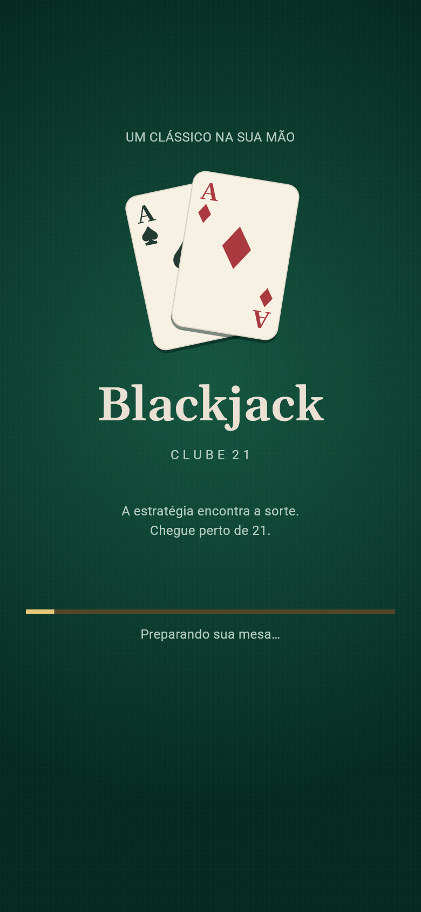</a></td>
<td><a href="imagens/02-menu.png">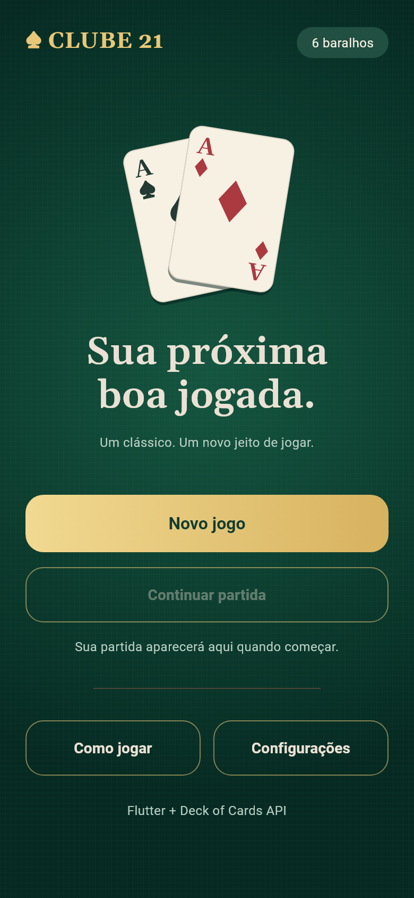</a></td>
<td><a href="imagens/03-menu-ativo.png">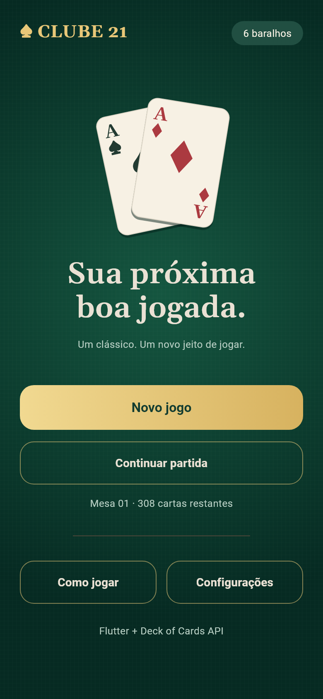</a></td>
</tr>
</table>

<table>
<tr>
<th>04 · Configurações</th>
<th>05 · Como jogar</th>
<th>06 · Distribuição</th>
</tr>
<tr>
<td><a href="imagens/04-configuracoes.png">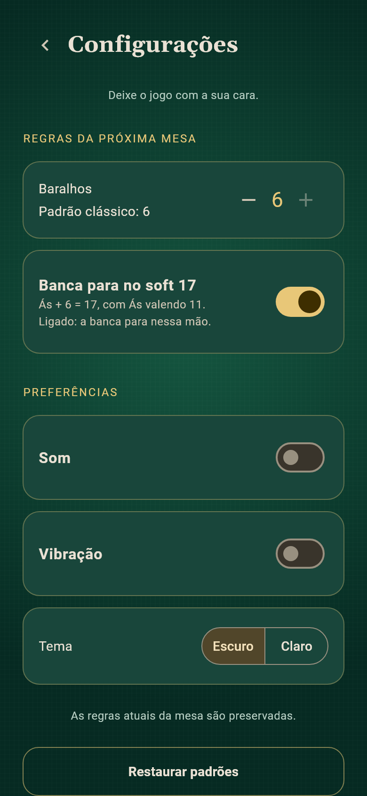</a></td>
<td><a href="imagens/05-regras.png">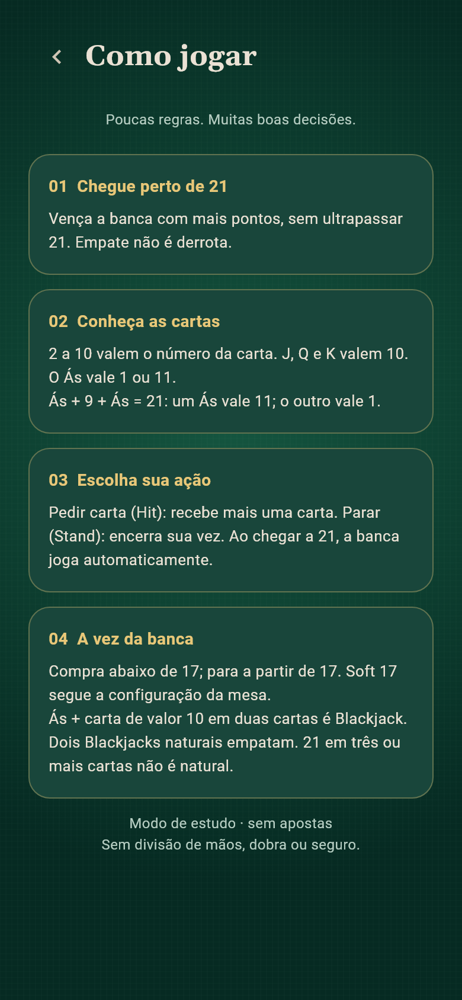</a></td>
<td><a href="imagens/06-distribuindo.png">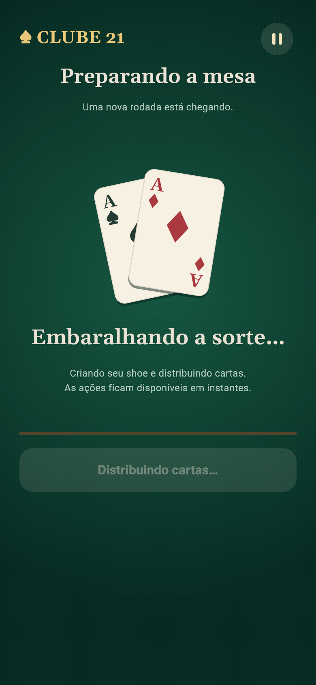</a></td>
</tr>
</table>

<table>
<tr>
<th>07 · Sua vez</th>
<th>08 · Ás flexível</th>
<th>09 · Vez da banca</th>
</tr>
<tr>
<td><a href="imagens/07-sua-vez.png">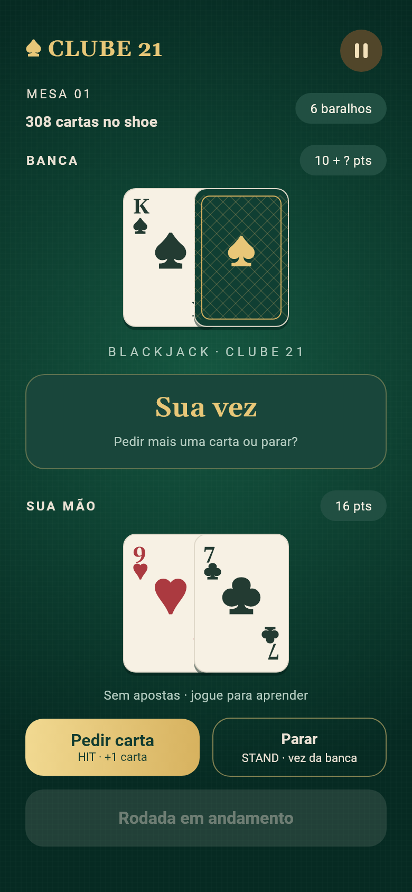</a></td>
<td><a href="imagens/08-as-flexivel.png">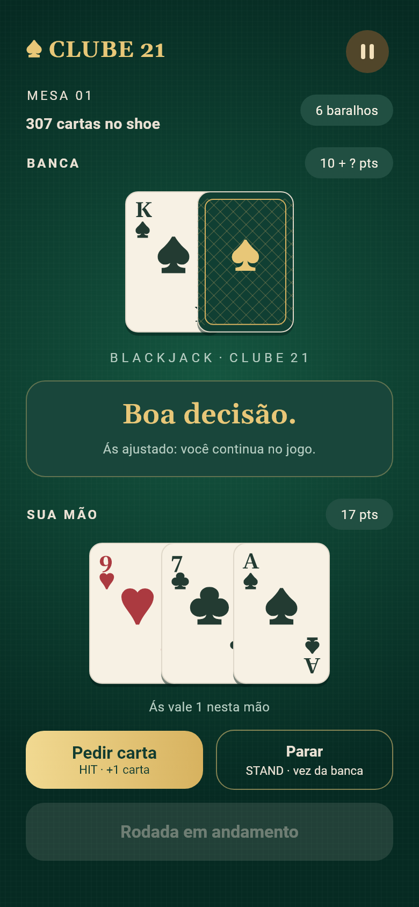</a></td>
<td><a href="imagens/09-banca.png">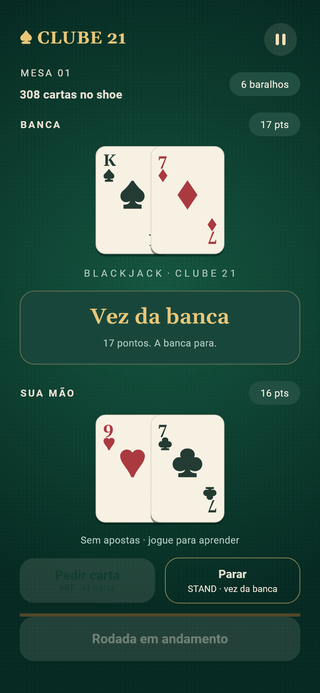</a></td>
</tr>
</table>

<table>
<tr>
<th>10 · Blackjack do jogador</th>
<th>11 · Vitória</th>
<th>12 · Empate</th>
</tr>
<tr>
<td><a href="imagens/10-blackjack.png">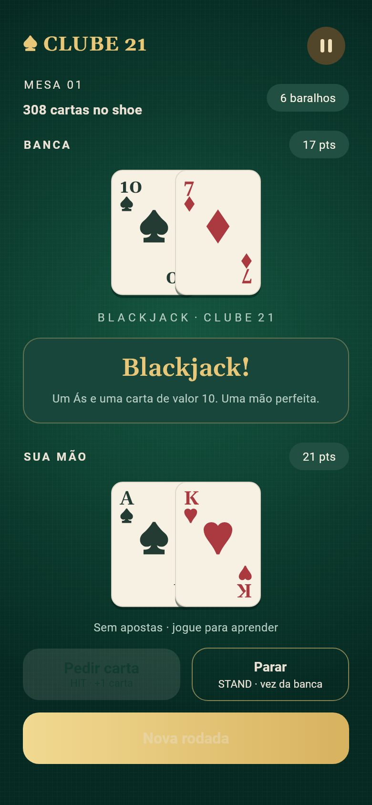</a></td>
<td><a href="imagens/11-vitoria.png">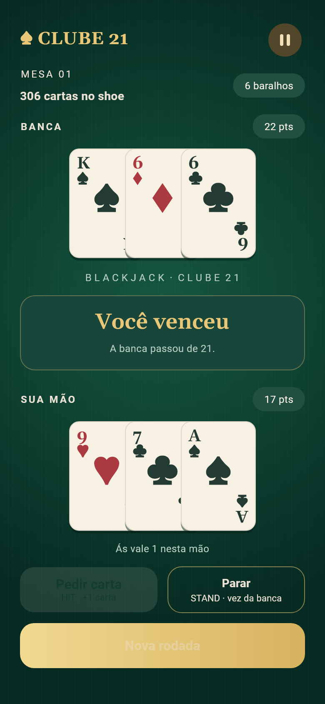</a></td>
<td><a href="imagens/12-empate.png">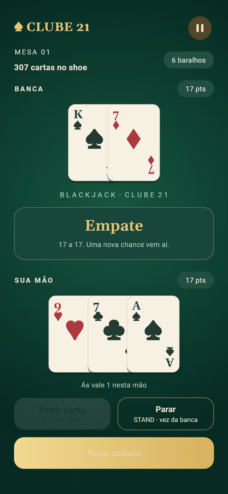</a></td>
</tr>
</table>

<table>
<tr>
<th>13 · Derrota</th>
<th>14 · Estouro do jogador</th>
<th>15 · Erro ao criar a mesa</th>
</tr>
<tr>
<td><a href="imagens/13-derrota.png">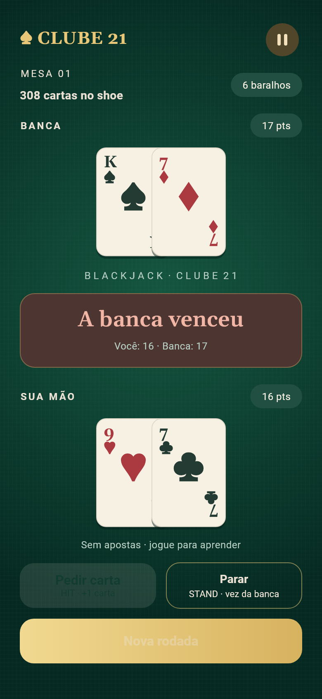</a></td>
<td><a href="imagens/14-estouro.png">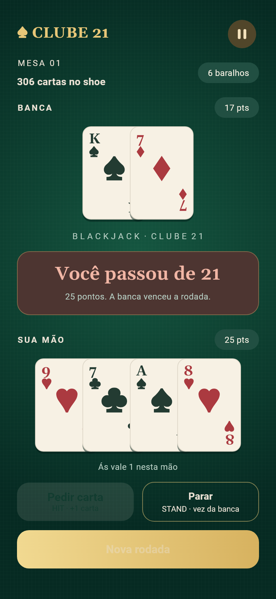</a></td>
<td><a href="imagens/15-erro-conexao.png">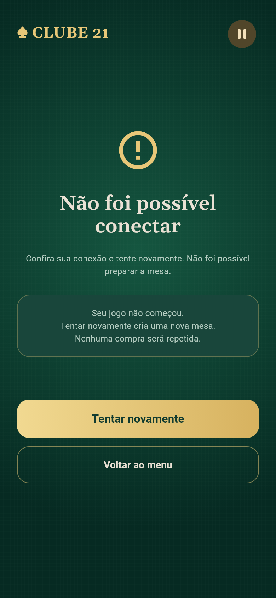</a></td>
</tr>
</table>

<table>
<tr>
<th>16 · Compra incerta</th>
<th>17 · Renovação do shoe</th>
<th>18 · Pausa</th>
</tr>
<tr>
<td><a href="imagens/16-compra-incerta.png">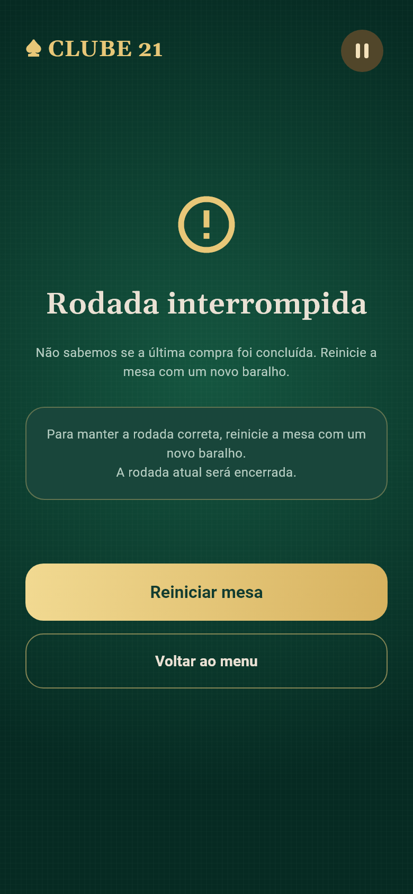</a></td>
<td><a href="imagens/17-renovar-shoe.png">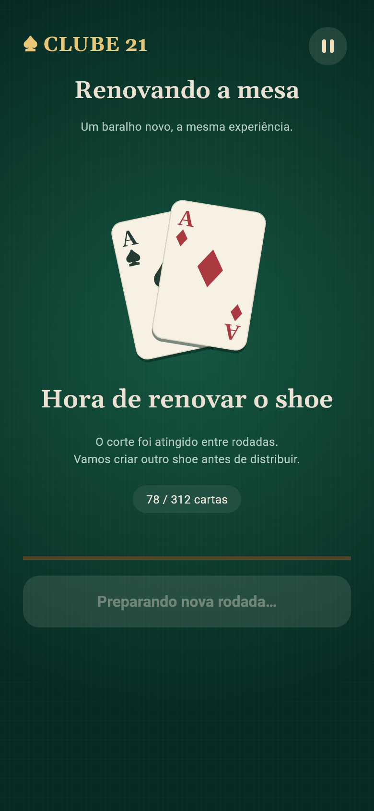</a></td>
<td><a href="imagens/18-sair.png">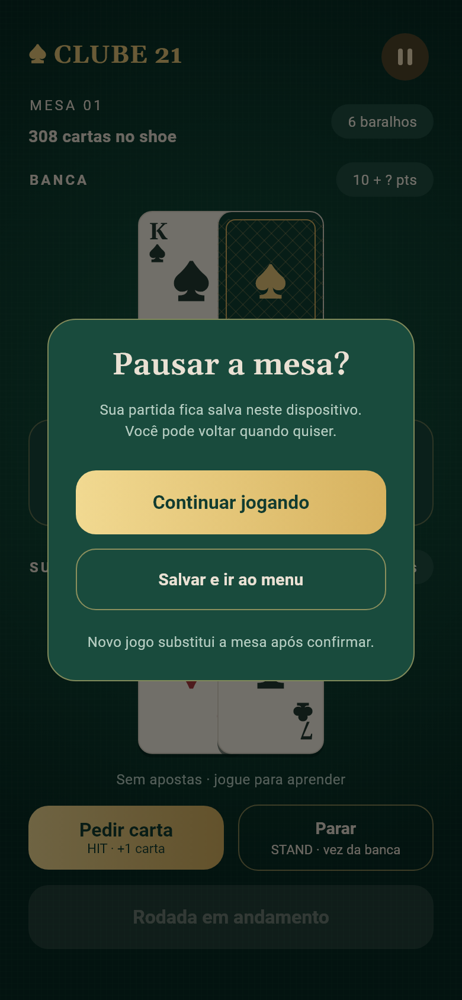</a></td>
</tr>
</table>

<table>
<tr>
<th>19 · Blackjack da banca</th>
</tr>
<tr>
<td><a href="imagens/19-blackjack-banca.png">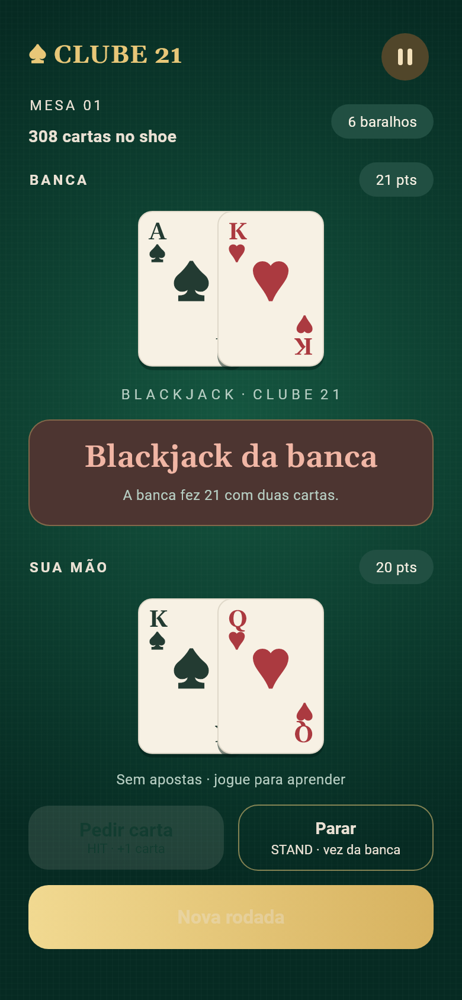</a></td>
</tr>
</table>
